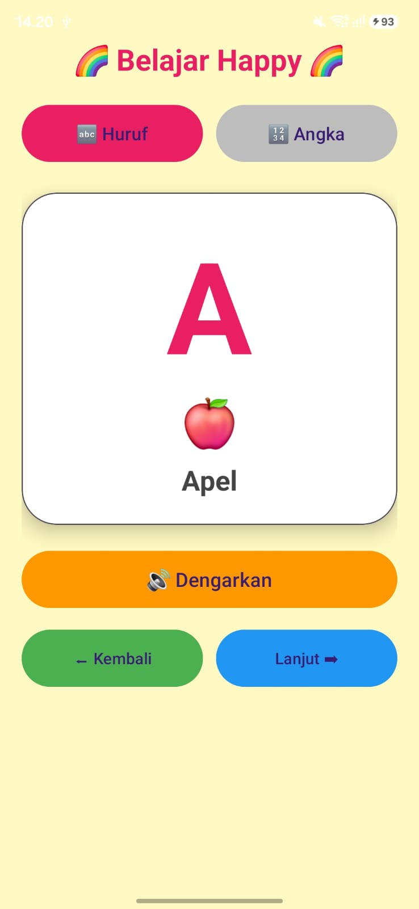
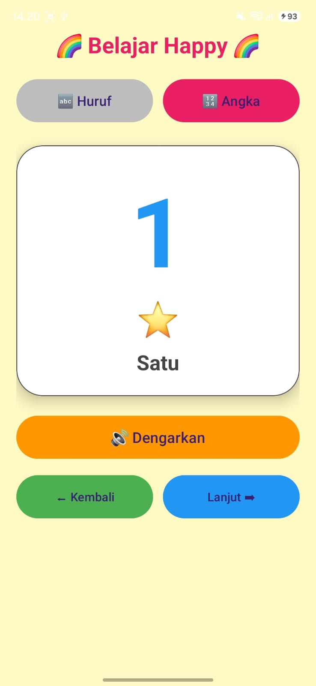

# Tugas 1 - Aplikasi Belajar Happy

Aplikasi **Belajar Happy** berbasis Android yang dikembangkan menggunakan Kotlin dan XML di Android Studio. Dibuat untuk membantu anak-anak mengenal huruf dan angka.

## 📱 Fitur Aplikasi

1. **Belajar Huruf**: huruf A-Z lengkap dengan gambar emoji dan nama benda (A = Apel, B = Bola, dst).
2. **Belajar Angka**: angka 0-9 dengan nama dalam bahasa Indonesia.
3. **Tombol Dengarkan**: mengucapkan huruf/angka memakai Text-to-Speech bahasa Indonesia.
4. **Tombol Kembali / Lanjut**: berpindah ke huruf atau angka sebelumnya dan berikutnya.

## 🛠️ Komponen UI yang Digunakan

- **ViewGroup**: LinearLayout, ScrollView, MaterialCardView
- **View Widgets**: TextView, MaterialButton
- **Lainnya**: Text-to-Speech, warna huruf berganti otomatis

## 🚀 Cara Menjalankan

1. Buka project di Android Studio
2. Hubungkan HP (USB debugging aktif) atau jalankan emulator
3. Klik tombol **Run**

## 📷 Tangkapan Layar

| Belajar Huruf | Belajar Angka |
|:---:|:---:|
|  |  |

## 👤 Pembuat

NESWA AIDA FATHIRA - 24091018
